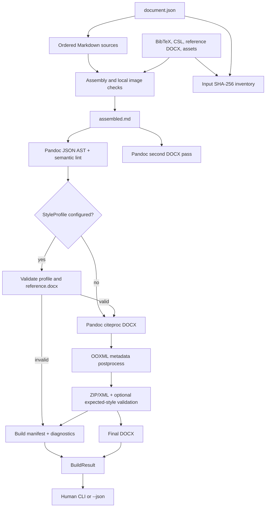

# Architecture

## Components

| Component | Responsibility | Input | Output |
|---|---|---|---|
| `build.py` | CLI, human/JSON output and exit status | delivery path, `--json` | output and process status |
| `document.json` | ordered sections, metadata, paths, output names | user config | pipeline settings |
| `docskill.pipeline` | assembly, Pandoc passes, output/package orchestration, opt-in style validation and manifest | delivery | `run_build()` returns `BuildResult`; `build_delivery()` retains its path-returning API |
| `docskill.style_profile` | parse semantic role mappings and inspect required OOXML parts/styles in an explicit reference DOCX | profile + reference DOCX | validation state and diagnostics; post-render style usage checks |
| `docskill.diagnostics` | stable diagnostic and result contracts | pipeline stage results/errors | JSON-serializable objects |
| `docskill.ooxml` | set core metadata and field-refresh setting using standard library | Pandoc DOCX | final DOCX |
| `docskill.validate` | check ZIP integrity, document XML and output existence | final DOCX | validation messages |
| `tests/fixtures/` | neutral input corpus and generated golden DOCX | sources through current pipeline | regression reference |

## Pipeline

## Diagnostic and result contract

`Diagnostic` contains `code`, `severity`, `message`, `phase`, optional `source`, and optional `block_id`. Severities: `info`, `warning`, `error`, `fatal`. `BuildResult` contains success, a delivery-relative output path, diagnostics, and manifest. The implementation adapts existing exceptions at the build boundary; internal exceptions have not all been replaced.

Current stable failure codes: `PANDOC_FAILED`, `BUILD_INPUT_INVALID`, `INPUT_FILE_NOT_FOUND`, `BUILD_IO_FAILED`, `BUILD_FAILED`. Add a new code for a distinct condition rather than repurposing an existing one.

## Manifest

`build/manifest.json` uses `schema_version: 1`. It records docskill/Python/Pandoc versions; configuration, Markdown, optional BibTeX/CSL/reference DOCX/assets and output SHA-256; delivery-relative paths; build status and diagnostic details/counts. When opted in, it additionally records StyleProfile path/hash/schema/name/version and the reference template hash, required/found/missing styles, and inspected OOXML parts. On failure it attempts to emit a failure manifest plus `build/diagnostics.json`. Diagnostic messages redact absolute paths.

The manifest provides provenance, not proof of byte-identical output across renderers, fonts or templates.

## DOCX baseline

`tests/fixtures/DOCX_Baseline_Fixture.docx` is generated from the neutral corpus by this pipeline. Tests compare full ZIP member inventory, selected canonicalized XML parts, metadata and media bytes, not the entire DOCX ZIP binary. Visual layout is not part of the automated regression suite.

## Boundaries

The current pipeline is Markdown → Pandoc/citeproc → DOCX → focused OOXML postprocessing. Pandoc AST semantic checks run before rendering and map unique AST nodes back to original Markdown paths where possible. StyleProfile is an opt-in semantic role-to-Word-style contract: the reference DOCX controls presentation, and validation checks required template styles before rendering plus actual paragraph/table style use afterward. The build generates DOCX files; it does not import and edit arbitrary existing Word documents.
